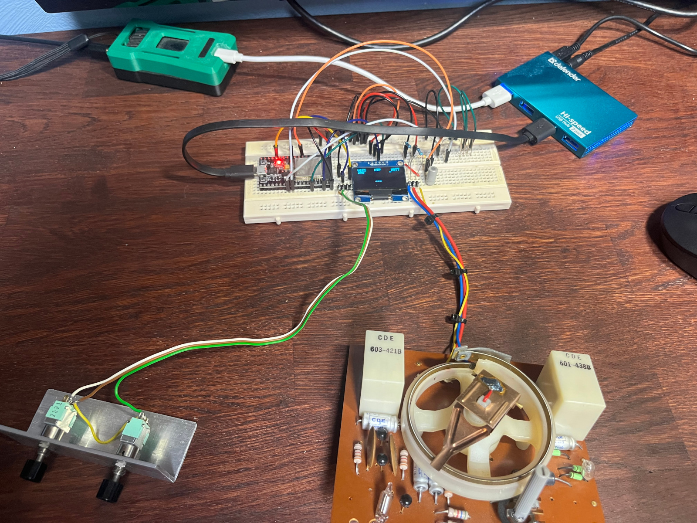
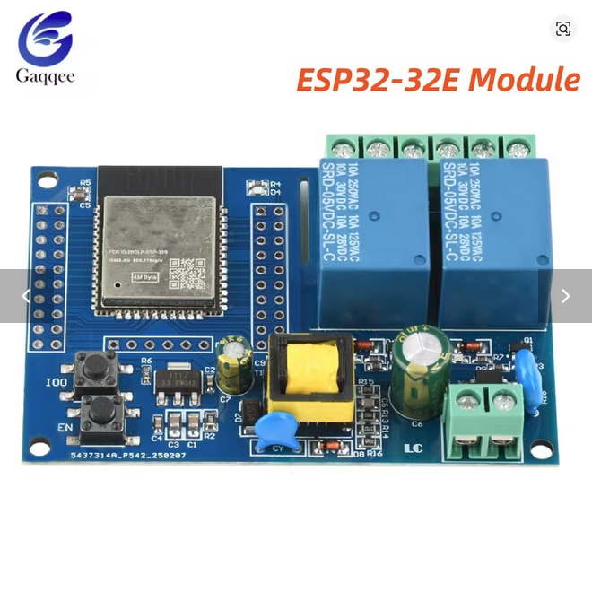
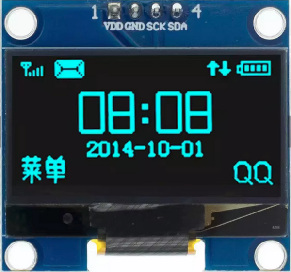
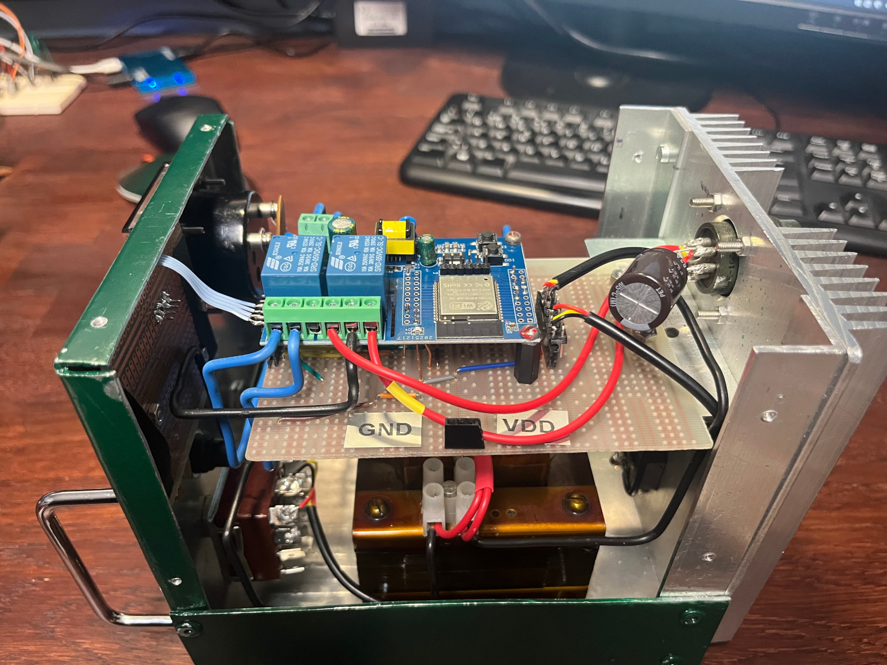
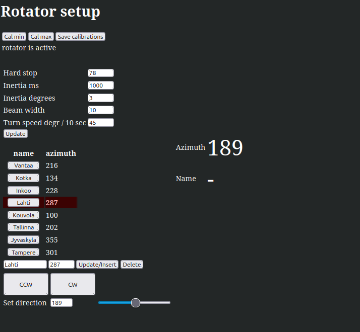

# rotator
esp32 antenna rotator control

Backgound:

I had a Cornell Dubilier AR-40 rotator with a bad controller. So I decided to build my own controller. I already
had a 40 year old and non complete power supply project having a 100w 24v transformer in it. Old controllers potentiometer
is exact copy from what is inside the rotator housing. So I can use this potentiometer as a tabletop test rotator.
First I tried to use a Chinese digital voltmeter as a position indicator. Aim: 3.6v is 360 degrees 1.8v is 180 degrees 
and so on. I just had to feed correct voltage to rotators potentiometer. This idea was quite good, but the voltmeter 
did not show anything under 0.3v. So I would be quite blind in small degrees.

The current idea is to use an esp32 board to read potentiometers analog value and convert this to degrees. Rotators
potentiometer is 1000 ohm linear, showing whole 360 degrees. It is constructed so that it is like first 360 degrees
of a spring. Voltages received from the potentiometer should be something between 150 mV – 1750 mV. Rest is just
calibration and interpolation between calibration points. 

In protoboard image, don't let the components around the big potentiometer confuse you. Only the potentiometer is
used here. All the rest components on the board are just junk from the old controller.

Esp32 controller should also need a pair of relays to switch on the alternate current feed to the rotator. 
This rotator needs 24v ac. One common wire, cw wire and ccw wire. Aliexpress sends a nice board having esp32,
a tiny power source from 230v to 5v and two relays. This is perfect for me.

To show some information in the rotator controller box, I added also a tiny oled display. 
This is the 4 wire version, using I2C bus. Bus needs two wires in addition to power and ground wires.
My aim is to use pc/ipad/mobilephone as display, so I don't need a anything special to controllers dash.

Connections are:

1. Rotator azimuth potentiometer, 0 - 1000ohm
2. Two relays, first puts the 230v power to the transformer, second selects rotation direction
3. Direction buttons, clockwise or counterclockwise
4. tiny 1.3 inch display to show some info.

Features:
1. Some pre-defined directions can be stored into esp32 flash memory, these directions are shown
   in the display, if antenna is turned close enough to these directions.
2. If connected to a mqtt server via wifi, all controlling can be done with a web interface.
3. Web setup interface allows rotator settings update and simple control.
   settings are: hard-stop - hard stop is not needed to be in 0 degrees, it can be anything between 0 and 359.
                 inertia seconds - how long time the antenna is rotatin after power is cut after turning.
                 inertia degrees - how many degrees the turning continues after power cut. This is used to 
                                   cut the power before the target azimuth is reached.
                 beamwidht in degrees - for optimising need to turn.
4. Web based graphical map interface using openStreetMap and Leaflet library. This interface shows antenna direction
   like a beam over a map. Turn direction can be done by clicking the map, or by html buttons. These buttons same
   as the directions mentioned earlier in feature 1. 

Next picture is from the actual hardware. The casing and transformer were originally ( 40 years ago ) going to be
a variable voltage power supply. It was staying quite a many years in my store. A short time ago I realized the 
transformer is perfect to this project, so was the casing too. This is the reason there is cooling fins at the
back side, and a voltage meter in front. I am using a robust mil-grade connector to the rotator, proto-pcb 
under the esp32-relay board and so on. Rigid blue wires to the front relay are for 230v to the transformer and
second relay handles the direction. Rigid black wire comes from transformers 24v coil, via a fuse.

Next is a screenshot of the setup display. There already one shortcut city under edit, I have clicked line of the city,
it is marked with red and copiec on working line. Name and azimuth can be edited there and saved from the button right.

Following screenshot is from web interface. Background is an OpenStreetmap layer of my hometown Nastola. Home location
in this map is not my house, it is Nastola Municipal house, currently under demolition. This position is coded in the
javascript part as default location. Actual home location is received from mqtt, see the description on mqtt topics.
On right you can see the shortcut buttons of various locations. These locations can be administered with the setup display.
The two most top buttons are clockwise and counterclockwise buttons. 

Rotator software depends heavily on mqtt. [Topics are listed here](docs/topics.md)
You should have a mosquitto server running somewhere in your network. I have it running in an old raspberry pi.
This same mosquitto handles all my homesystem messages too.
