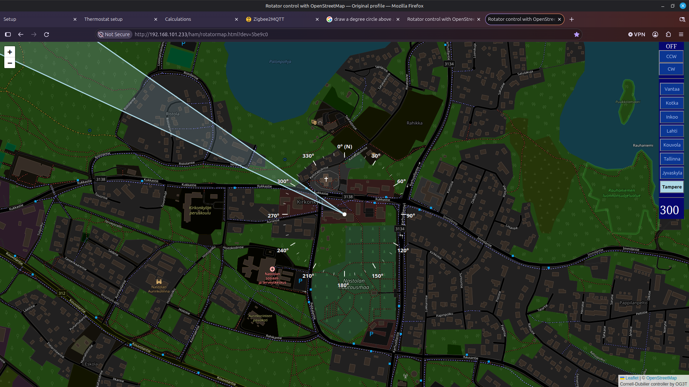

# rotator
esp32 antenna rotator control

Backgound:

I had a Cornell Dubilier AR-40 rotator with a bad controller. First I tried to use a Chinese digital voltmeter as
a position indicator. Aim: 3.6v is 360 degrees 1.8v is 180 degrees and so on. I just had to feed correct voltage
to rotators potentiometer. This idea was quite good, but the voltmeter did not show anything under 0.3v. So I would
be quite blind in small degrees.

The current idea is to use an esp32 board to read potentiometers analog value and convert this to degrees. Rotators
potentiometer is 1000 ohm linear, showing whole 360 degrees. It is constructed so that it is like first 360 degrees
of a spring. Voltages received from the potentiometer should be something between 150 mV – 1750 mV. Rest is just
calibration and interpolation between calibration points. Esp32 controller should also need a pair of relays to 
switch on the alternate current feed to the rotator. This rotator needs 24v ac. One common wire, cw wire and ccw wire.
Aliexpress sends a nice board having esp32, a tiny power source from 230v to 5v and two relays. This is perfect for me.

Connections are:

1. Rotator azimuth potentiometer, 0 - 1000ohm
2. Two relays, first puts the 230v power to the transformer, second selects rotation direction
3. Direction buttons, clockwise or counterclockwise
4. tiny 1.3 inch display to show some info.

Features:
1. Some pre-defined directions can be stored into esp32 flash memory, these directions are shown
   in the display, if antenna is turned close enough to these directions.
2. If connected to a mqtt server via wifi, all control can be done with a web interface.
3. Web interface allows rotator settings update and simple control.
4. Web based graphical map interface using openStreetMap and Leaflet library. This interface shows antenna direction
   like a beam over a map. Turn direction can be done by clicking the map, or by html buttons.

